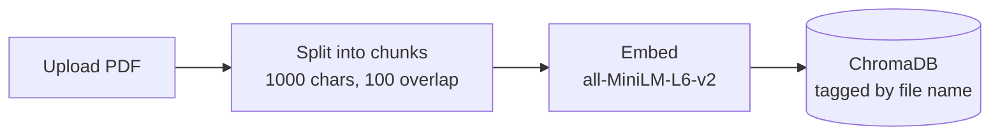

# RAG PDF Assistant

Chat with one or more PDFs. Upload documents, ask questions, and get answers grounded in the text, with the source file and page shown for every answer.

Built with FastAPI, Streamlit, LangChain, ChromaDB, HuggingFace embeddings and Groq.


## Features

- Upload multiple PDFs and search across all of them or just one
- Answers are grounded in the document, with source file and page numbers
- View the exact text chunks used to produce each answer
- Delete documents from the sidebar; re-uploading a file replaces the old copy
- Filters out table-of-contents and index chunks to improve retrieval quality
- Clear error for scanned PDFs that contain no extractable text
- REST API with built-in docs at `/docs`

## How it works

### 1. Indexing (on upload)



### 2. Question answering


MMR (Maximal Marginal Relevance) picks chunks that are relevant but not near-duplicates of each other. The LLM only sees the retrieved chunks and the question, and is told to answer from them alone.

## Tech stack

| Part | Tool |
|---|---|
| UI | Streamlit |
| API | FastAPI + Uvicorn |
| RAG framework | LangChain |
| Vector store | ChromaDB |
| Embeddings | HuggingFace `all-MiniLM-L6-v2` |
| LLM | Groq (`openai/gpt-oss-20b`) |

## Project structure

```
.
├── app.py            # Streamlit UI
├── backend.py        # FastAPI routes
├── rag_core.py       # All RAG logic (embeddings, Chroma, LLM, prompt)
├── main.py           # Optional terminal version
├── requirements.txt
├── .env.example
└── README.md
```

## Setup

1. Clone the repo and enter the folder:
   ```bash
   git clone https://github.com/YOUR_USERNAME/rag-pdf-assistant.git
   cd rag-pdf-assistant
   ```

2. Create a virtual environment and install packages:
   ```bash
   python -m venv venv
   venv\Scripts\activate        # Windows
   # source venv/bin/activate   # macOS / Linux
   pip install -r requirements.txt
   ```

3. Create a `.env` file (copy `.env.example`) and add your key from [console.groq.com](https://console.groq.com):
   ```
   GROQ_API_KEY=your_groq_api_key_here
   ```

## Run

Use two terminals in the project folder. Start the backend first.

**Terminal 1: API**
```bash
uvicorn backend:app --reload
```
Wait for "RAG system created and ready!" The first run downloads the embedding model, so it can take a minute.

**Terminal 2: UI**
```bash
streamlit run app.py
```
Open http://localhost:8501.

## Usage

1. Upload one or more PDFs in the sidebar and click **Process Documents**.
2. Pick **All documents** or a single PDF in **Search in**.
3. Ask a question in the chat box.
4. Open **View Source Documents** to see which file and page each answer came from.

## API

| Method | Endpoint | Description |
|---|---|---|
| POST | `/upload` | Upload and index a PDF |
| GET | `/documents` | List loaded PDFs with chunk counts |
| DELETE | `/documents?name=...` | Remove a PDF |
| POST | `/ask` | Ask a question (`question`, optional `document`) |

Interactive docs: http://127.0.0.1:8000/docs

## Known limitations

- Scanned PDFs are not supported (no OCR)
- One shared document store, so all users of a running instance see the same documents
- No chat memory in the prompt; each question is answered independently
